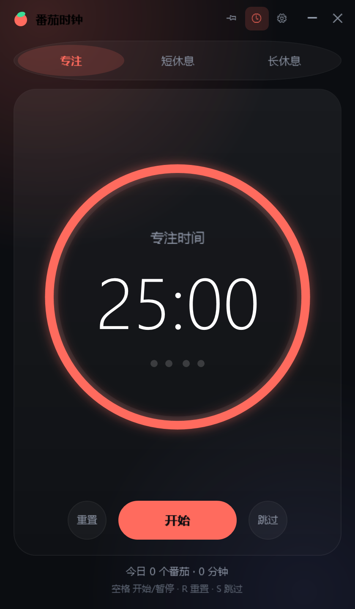
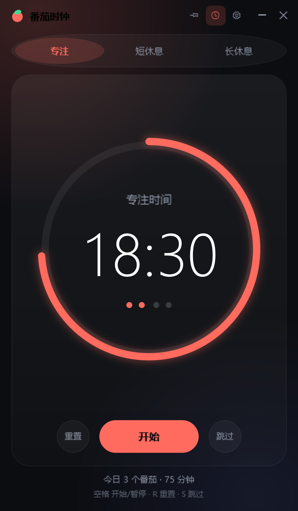
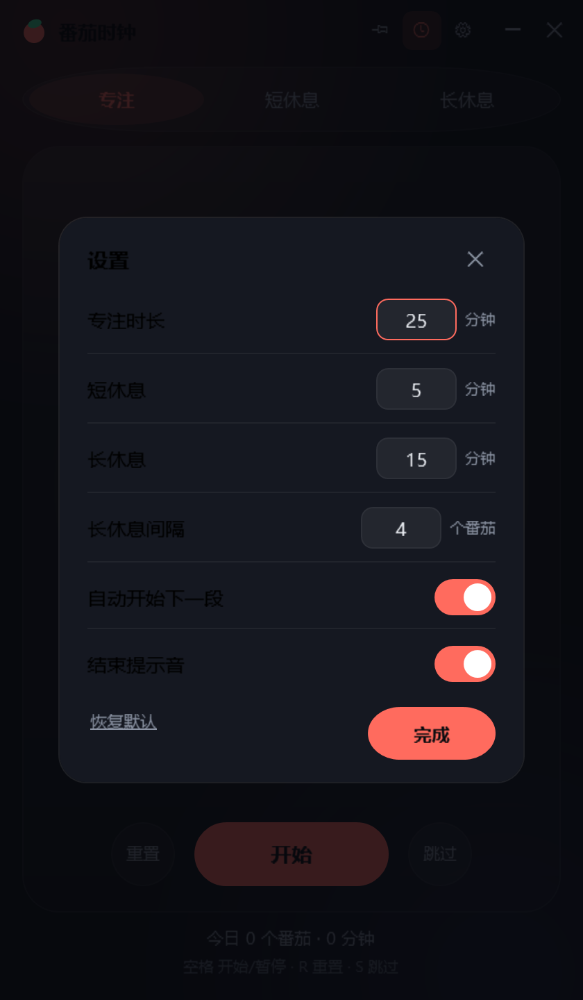
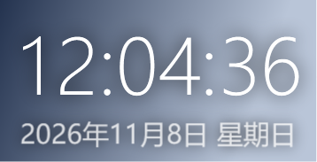
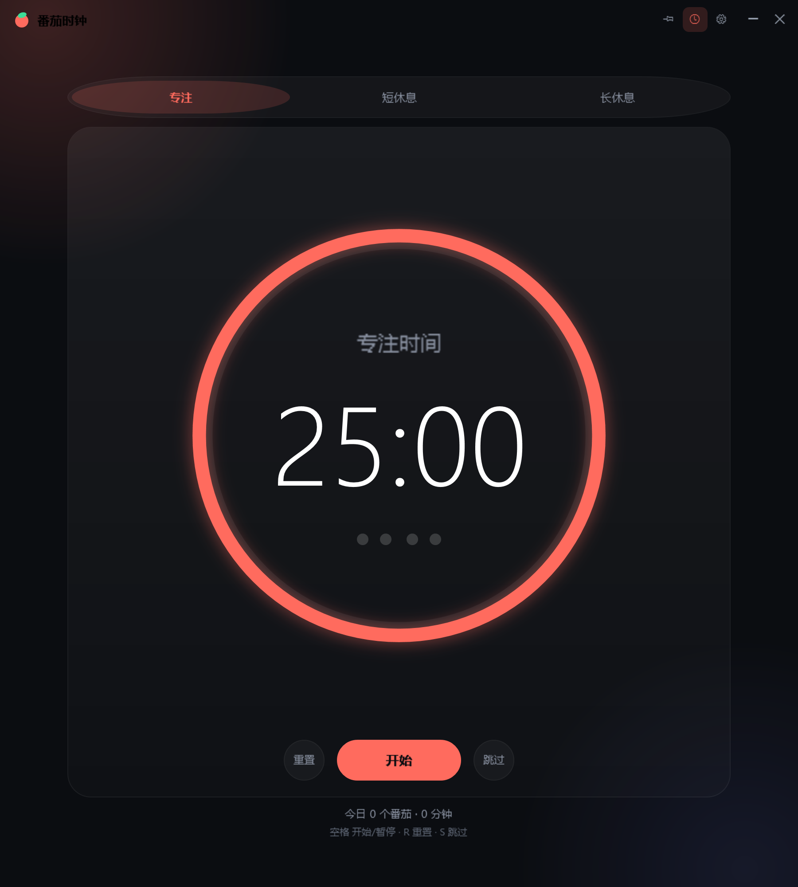

# izumimal-屏幕时间 [beta0.01]

免安装的 Windows 桌面番茄钟 + 透明桌面时钟。单文件 exe，双击即用。



## 下载

到 [Releases](../../releases/latest) 下载 **`izumimal-screen-time-beta0.01-win.zip`**，解压后双击 `番茄时钟.exe`。

- 系统要求：Windows 10 1809 及以上 / Windows 11
- 不需要安装 .NET（系统自带的 .NET Framework 4.8 即可运行）
- 不写注册表，卸载就是删掉文件夹

## 功能

- **番茄计时**：专注 25 分钟 / 短休息 5 分钟 / 长休息 15 分钟，每完成 4 个番茄自动进入长休息
- **窗口可自由缩放**：拖拽边缘调整大小，尺寸会记住；最大化时内容自动居中、不会被裁切
- **窗口置顶**：标题栏图钉按钮，状态会记住
- **透明桌面时钟**：时间 + 日期浮窗，始终置顶
  - 左键拖动位置，滚轮直接调字号
  - 右键菜单：显示日期 / 显示秒 / 半透明背景 / 字号 / 锁定位置 / 鼠标穿透 / 隐藏
  - 位置与字号自动保存
- **进度环 + 倒计时**，剩余时间同步显示在任务栏标题
- **结束提示音**（程序内合成，无需音频文件）
- **今日统计**：完成番茄数与专注分钟数，跨天自动清零
- **系统托盘**：打开主窗口、显示/隐藏时钟、取消鼠标穿透、退出

## 快捷键

| 按键 | 作用 |
| --- | --- |
| `空格` | 开始 / 暂停 |
| `R` | 重置当前计时 |
| `S` | 跳过当前阶段 |
| `1` `2` `3` | 切换 专注 / 短休息 / 长休息 |
| `Esc` | 关闭设置面板 |

## 界面

| 计时中 | 设置 |
| --- | --- |
|  |  |

| 桌面时钟 | 拉宽窗口 |
| --- | --- |
|  |  |

## 配置

优先保存在 `%APPDATA%\PomodoroTimer\settings.ini`（纯文本，可直接编辑）。
若该位置不可写（受限账户、只读环境等），会自动改用程序目录下的 `PomodoroTimerData\settings.ini`。

删除该文件即可恢复全部默认设置。

## 从源码构建

需要 Windows 自带的 .NET Framework 4.8 编译器（`C:\Windows\Microsoft.NET\Framework64\v4.0.30319\csc.exe`），不需要 Visual Studio。

```bat
build.cmd
```

或：

```powershell
powershell -NoProfile -ExecutionPolicy Bypass -File .\build.ps1
```

产物为 `dist\番茄时钟.exe`（约 130 KB，单文件，图标与 XAML 均嵌入），构建脚本会自动生成 `build\app.ico`。

## 源码结构

```
src/
  Program.cs        入口、单实例、崩溃日志、XAML 资源加载
  MainWindow.cs     主窗口逻辑（计时、缩放、置顶、设置面板）
  MainWindow.xaml   主界面布局与样式
  ClockWindow.cs    桌面时钟浮窗（拖动、滚轮缩放、右键菜单、鼠标穿透）
  ClockWindow.xaml  时钟浮窗布局
  TimerEngine.cs    计时状态机（番茄流转、统计）
  Preferences.cs    settings.ini 读写（含便携回退）
  Chime.cs          提示音（运行时合成 WAV）
  Ring.cs           圆环进度几何计算
  TrayIcon.cs       托盘图标
  RenderHarness.cs  离屏渲染与自检（`--render selftest`）
  app.manifest      Per-Monitor V2 DPI 感知
build.ps1 / build.cmd
shots/              界面截图
index.html          同款设计的网页版（浏览器直接打开）
```

## 已知限制

- beta 版本，仅在 Windows 10/11 x64 上测试
- 主窗口关闭即退出程序（桌面时钟也会一起关闭）

## 反馈

有问题欢迎提 Issue。
